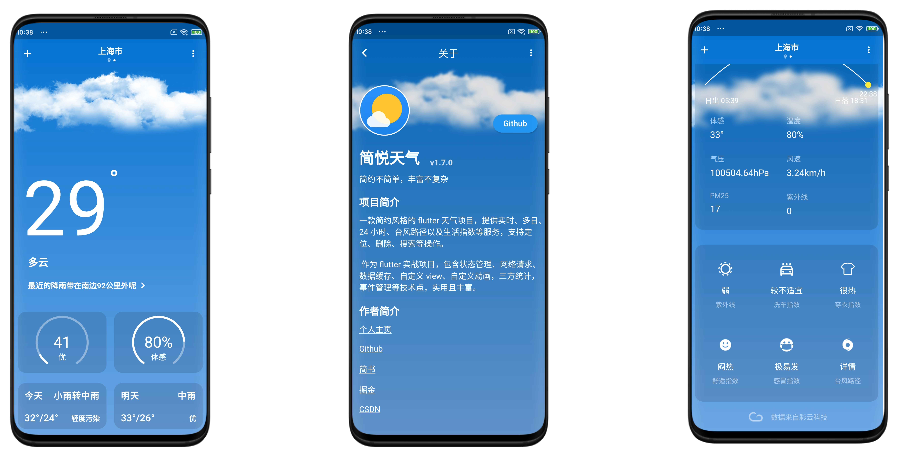
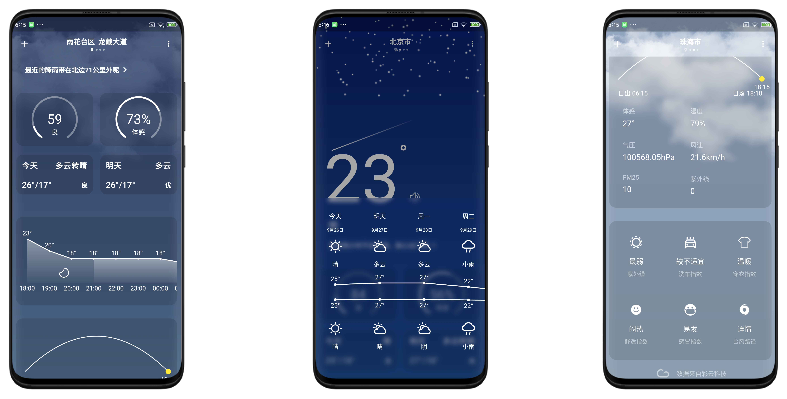
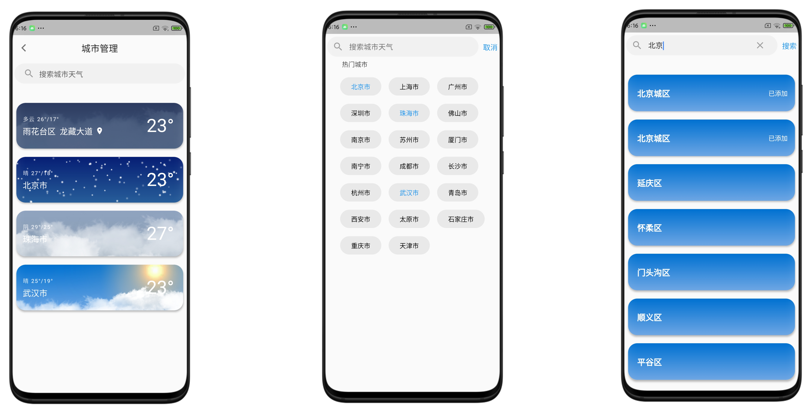
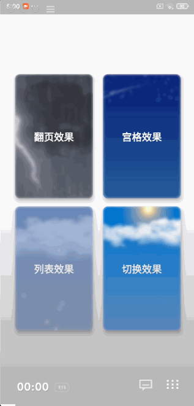
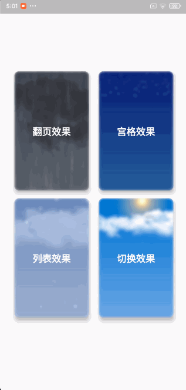
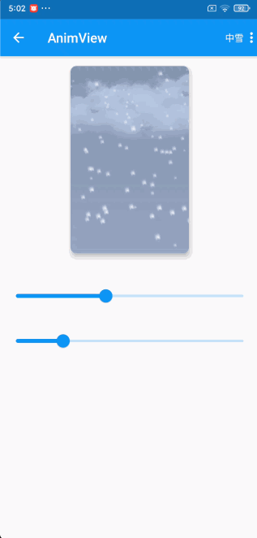

# 简悦天气

*简约不简单，丰富不复杂*

一款简约风格的 Flutter 天气项目，提供实时、多日、24 小时、台风路径以及生活指数等服务，支持定位、删除、搜索、语音播报等操作。

作为 Flutter 实战项目，包含状态管理、网络请求、数据缓存、自定义 View、自定义动画、事件管理等技术点，实用且丰富。

如果图片看不到，请前往 [『Flutter』一款风格简约功能丰富的天气](http://xiaweizi.cn/article/f7f8/)

### 运行要求

- Flutter `>= 3.0.0`
- Dart SDK `>= 3.0.0 < 4.0.0`（空安全）

项目已于 **2026/5** 完成 Flutter 3.x / Dart 3 空安全迁移，详见 [CHANGELOG](#changelog) 3.0.0 条目。

### 快速体验

```bash
git clone https://github.com/xiaweizi/SimplicityWeather.git
cd SimplicityWeather
flutter pub get
flutter run                # 连真机或模拟器
# 或
flutter run -d chrome      # Web 版（无需定位权限）
```

> 默认的高德 / 彩云 API Key 已被作者撤销，接口调用会失败。请在 `lib/net/net_manager.dart` 与
> 高德相关代码里填入你自己的 Key 即可看到真实数据；**不填也能正常启动进首页**（只是数据空）。

### 功能介绍

- [x] 自动定位（从高德 SDK 迁移到 `geolocator`）
- [x] 添加&删除城市
- [x] 实时信息
- [x] 24 小时 & 多日预报
- [x] 丰富的生活指数
- [x] 台风路径
- [x] 背景高斯模糊
- [x] 动态降雨卡片
- [x] 丰富多样的天气背景效果（雷暴、流星等）
- [x] 语音播报
- [x] **一键换天**，做天气之子
- [x] 自动升级（`ota_update` 6.x，仅 Android）

接下来多图警告





#### 一键换天

天气背景效果分为三层：

- 背景颜色层。从上到下的渐变效果。
- 云层。只有一种图片，对其位移、数量、染色做不同变化达到不同效果。
- 雨雪层。为雨雪天气单独做了动画，很炫酷。

目前支持多达 **12** 种不同的天气类型：晴、多云、阴天、小中大雨、小中大雪、雾、霾、浮尘。为了更好，在关于页面右上角添加切换天气类型的入口，实时查看不同气象下不同的背景效果。下面用 GIF 图展示效果，鉴于 GIF 本身的局限，可能模糊低帧，请下载 APK 自行体验。







### 技术栈

| 领域       | 方案                                                                    |
| ---------- | ----------------------------------------------------------------------- |
| 状态管理   | `flutter_bloc` 9.x（BLoC 8 风格的 `on<Event>` handler）                  |
| 网络       | `dio` 5.x + 自建 `RepResult` 包装 / Interceptor                          |
| 本地存储   | `shared_preferences`                                                    |
| 定位 & 权限 | `geolocator` + `permission_handler`                                     |
| 屏幕适配   | `flutter_screenutil` 5.x                                                |
| 事件总线   | `event_bus`                                                             |
| 自定义绘制 | `CustomPainter`：AQI 圆弧、日出日落弧线、24h & 多日折线图、动态降雨卡片 |
| 自定义动画 | `AnimationController` + `TweenSequence`（语音播报、浪潮进度）           |
| 天气背景   | 本人开发的 [`flutter_weather_bg`](https://pub.dev/packages/flutter_weather_bg) 3.x |

### 三方库依赖

| 插件 | 说明 |
| ---- | ---- |
| [flutter_weather_bg](https://pub.dev/packages/flutter_weather_bg) | 本人开发的炫酷天气动态背景（3.x） |
| [flutter_bloc](https://pub.dev/packages/flutter_bloc) | 状态管理 |
| [equatable](https://pub.dev/packages/equatable) | 值对象相等性 |
| [shared_preferences](https://pub.dev/packages/shared_preferences) | 持久化保存数据 |
| [dio](https://pub.dev/packages/dio) | 网络请求 |
| [geolocator](https://pub.dev/packages/geolocator) | 跨平台定位 |
| [permission_handler](https://pub.dev/packages/permission_handler) | 权限申请 |
| [event_bus](https://pub.dev/packages/event_bus) | 事件总线 |
| [flutter_slidable](https://pub.dev/packages/flutter_slidable) | 侧滑列表 |
| [flutter_screenutil](https://pub.dev/packages/flutter_screenutil) | 屏幕适配 |
| [modal_bottom_sheet](https://pub.dev/packages/modal_bottom_sheet) | 底部弹窗 |
| [path_drawing](https://pub.dev/packages/path_drawing) | 绘制虚线 |
| [url_launcher](https://pub.dev/packages/url_launcher) | 打开外部链接 |
| [package_info_plus](https://pub.dev/packages/package_info_plus) | 读取包版本号 |
| [fluttertoast](https://pub.dev/packages/fluttertoast) | 轻量 Toast |
| [ota_update](https://pub.dev/packages/ota_update) | APK 自动升级（Android） |
| [flutter_tts](https://pub.dev/packages/flutter_tts) | 语音播报 |

### 感谢

- 天气数据来源于 [彩云科技](https://open.caiyunapp.com/Main_Page)
- 天气 icon 来自 [阿里 iconfont](https://www.iconfont.cn/)

> 定位功能原由 [高德地图](https://lbs.amap.com/) SDK 提供，2026 年版本起已改为跨平台的 `geolocator`。
> 早年高德 appkey 放在代码中被恶意刷爆账号，因此部分高德接口不再可用 —— 项目对接口失败会做容错，不影响整体运行。

### ChangeLog

#### 3.0.0 (2026/5)

- 迁移至 Flutter 3.x / Dart 3 空安全（`sdk: >=3.0.0 <4.0.0`）
- BLoC 6 → 9；dio 3 → 5；flutter_slidable 0.5 → 3；flutter_screenutil 4 → 5 等一批三方依赖升级
- `amap_location_fluttify` 已死，替换为 `geolocator`；`location_permissions` / `package_info` / `toast` 等已废弃包换成 `permission_handler` / `package_info_plus` / `fluttertoast`
- 移除友盟统计（作者未续签后台 appkey，保留业务代码干净）
- `flutter_weather_bg` 依赖升级到 3.0.0
- 重建 `android/` `ios/` 原生外壳：AGP 8、Gradle 8、Kotlin DSL，新增 `web/` 平台支持
- 修复大量 null-safety 相关运行时 bug（异步回调后 `setState` 未检查 `mounted` 等）

#### 2.6.0

- 新增城市管理动画效果
- 优化搜索结果页展示效果
- 新增炫酷的 demo 入口效果
- 优化背景动画效果

#### 2.5.0

- 更新背景动画依赖
- 修复定位失败 & 搜索失败 & 添加城市失败问题

#### 2.3.0

- 新增晴晚效果
- 新增流星效果

#### 2.2.0

- 新增 OTA 时更新说明
- 晴天新增太阳
- 支持语音播报功能
- 容错高德 API 次数限制处理

#### 2.1.0

- 新增自动更新
- 新增雷暴效果
- 新增动态降雨卡片
- 更换 iOS icon
- 修复删除城市后背景不更新问题

#### 2.0.0

- 优化雨雪绘制算法，提升雨雪类型的性能
- 新增雪花随风摇摆效果

#### 1.7.0

- 新增高斯模糊效果

#### 1.6.0

- 第一次提交
